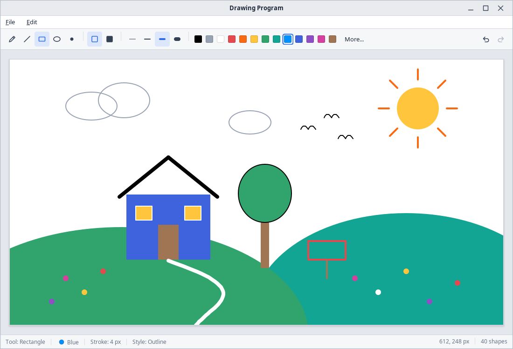

# Drawing Program

A small desktop drawing program written in Java Swing, using a model, view
and controller design. It uses only the Java standard library: the look,
the toolbar icons and the colour swatches are all drawn in code.



## Features

- **Five tools**: Pen (freehand), Line, Rectangle, Oval and Dot.
- **Live preview**: you see the shape while you drag.
- **Outline or fill** for rectangles and ovals.
- **Four stroke widths**: 1, 2, 4 and 8 pixels. The dot size follows the stroke width.
- **Colour palette** of 13 swatches, plus **More...** to pick any colour.
- **Undo and redo** for every change, including Clear.
- **Save as PNG** to export the drawing.
- **Status bar** with the current tool, colour, stroke width, style,
  cursor position and number of shapes.
- Smooth (antialiased) drawing on a white canvas.

## Keyboard shortcuts

| Keys | Action |
| --- | --- |
| Ctrl+N | New drawing |
| Ctrl+S | Save as PNG |
| Ctrl+Q | Exit |
| Ctrl+Z | Undo |
| Ctrl+Y or Ctrl+Shift+Z | Redo |
| Ctrl+Delete | Clear the drawing (can be undone) |
| P, L, R, O, D | Pen, Line, Rectangle, Oval, Dot |
| F | Switch between outline and fill |

## Prerequisites

- JDK 17 or newer.

## Build and run

With the script (builds `build/drawing.jar`):

```sh
./build.sh
java -jar build/drawing.jar
```

Or with plain `javac`:

```sh
javac -d build/classes src/drawing/*.java
java -cp build/classes drawing.App
```

## Tests

The tests are plain Java with no extra libraries. They check the model
(drawing, undo, redo, clear, stroke and fill per shape), paint the canvas
into an image and test the PNG export, so they need no screen.

```sh
./build.sh test
```

## Code layout

- `src/drawing/App.java`: starts the program and opens the window.
- `src/drawing/Model.java`: the shapes, the pen settings, and undo and redo.
- `src/drawing/Shape.java`: one shape and how to draw it.
- `src/drawing/View.java`: the menu bar, toolbar, canvas area and status bar.
- `src/drawing/DrawingPanel.java`: the canvas that paints the shapes and exports the image.
- `src/drawing/Controller.java`: turns mouse input into model calls.
- `src/drawing/Theme.java`: colours, fonts and the look and feel.
- `src/drawing/Icons.java`: toolbar icons drawn with Java2D.
- `src/drawing/FlatButtonUI.java` and `src/drawing/SwatchButton.java`: the toolbar buttons.
- `src/drawing/Palette.java`: the named colours.
- `test/drawing/Tests.java`: the tests.
